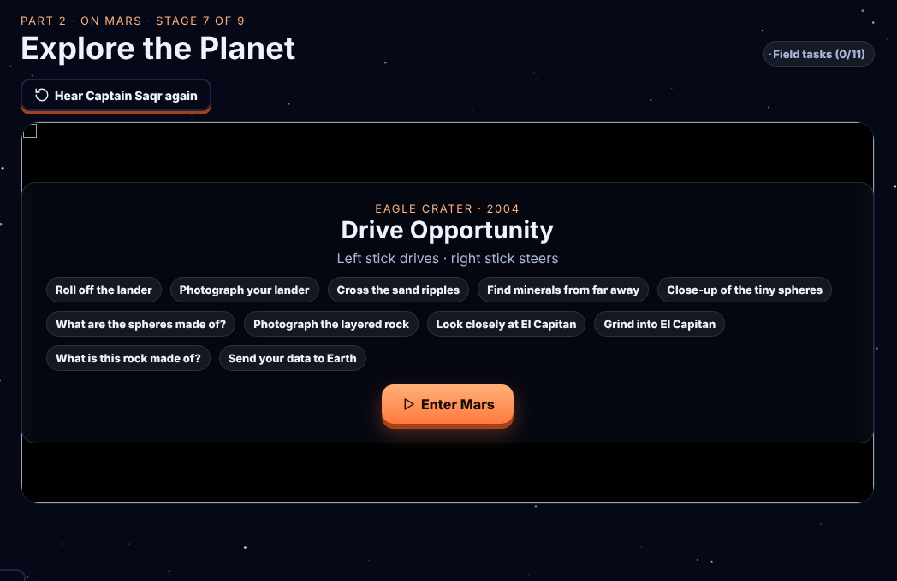

# ASTRO — Drive the rovers NASA left on Mars

**NASA Space Apps Challenge 2026 · Tabuk · Team Falaq**
**Challenge:** Abandoned but not Forgotten: Storytelling about NASA's Discarded Equipment on the Moon and Mars

## Play it
- **Live demo:** https://loolliiiii.github.io/ASTRO/ (GitHub Pages)
- Or download `index.html` and open it in any browser (phone, iPad or laptop). Needs an internet connection the first time (it loads three.js and fonts).

## The problem
More than 20 machines NASA sent to the Moon and Mars are now silent. Spirit and Opportunity changed what we know about Mars, but their story lives in reports and papers that most young people never read.

## Our solution
ASTRO is a 3D story game for students aged 10–18. The player:
1. Chooses the Spirit & Opportunity mission and meets the rover's real instruments.
2. Prepares the rover, launches and lands on Mars.
3. Drives Opportunity across Eagle Crater and completes 11 field tasks: photograph the lander, cross sand ripples, find hematite from far away with Mini-TES, zoom in on the "blueberries", grind into El Capitan with the Rock Abrasion Tool, read its chemistry with APXS, and send the data to Earth.
4. Is guided by **Captain Saqr** (voice and hints).
5. Reads the true story of how each rover's mission ended and what it means for Earth.
6. Collects robot cards and designs their own mission in the Design Lab.

The game has 9 stages: Ready to travel → Choose mission → Briefing → Robot & equipment → Preparation → Launch & landing → Explore the planet → Mission accomplished → Not forgotten.

## NASA data used
See [NASA-Data-Sources.md](NASA-Data-Sources.md). In short: NASA/JPL Mars Exploration Rover mission results (hematite "blueberries", El Capitan layered rock, sulfur-rich salts, distances and mission dates), NASA/JPL rover artwork and NASA 3D Resources planet textures.

## How to run locally
No install or build step. Open `index.html` in a browser.
Built with HTML, CSS, JavaScript and [three.js](https://threejs.org/) r128.

## Repository contents
| File | What it is |
|---|---|
| `index.html` | The full game (code and images in one file) |
| `ASTRO-Presentation.pdf` | 7-slide project presentation |
| `NASA-Data-Sources.md` | NASA data and resources we used |
| `screenshot.png` | Game screenshot |
| `LICENSE` | MIT License |

## Team Falaq
Layan Alghamdi · Lama Ali Alamri · Layan Ali Aljohani · Fajer AlOtaibi · Hajar Aldham

## AI disclosure
We used Claude (Anthropic) as an AI assistant to help write the game code, the texts and this documentation. The idea, design choices and content review were done by the team.

*Made for the 2026 NASA Space Apps Challenge. Not an official NASA product.*
