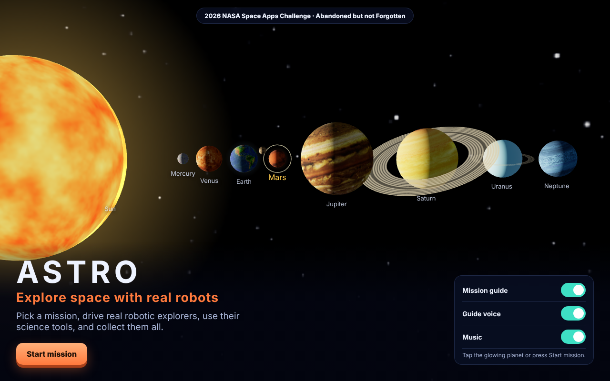

# ASTRO 🚀

**A 3D game where young players drive NASA's retired rovers and relive their missions, stage by stage.**

| Challenge | Team | City | Event |
|---|---|---|---|
| Abandoned but not Forgotten | Falaq | Tabuk, Saudi Arabia | NASA Space Apps Challenge 2026 (local partner: ETRA) |



▶️ **Play it live:** open `index.html` (or `src/index.html`) in any modern browser. If GitHub Pages is on for this repository, the game runs at `https://<your-username>.github.io/<repo-name>/`.

📑 **Pitch deck:** [docs/ASTRO_Pitch_Deck_Falaq.pdf](docs/ASTRO_Pitch_Deck_Falaq.pdf)

---

## 1. The problem

December 1972: two astronauts parked their car on the Moon, aimed its camera at their spacecraft and flew home. The car filmed them leaving, and it is still parked there.

It is one of hundreds of objects NASA left on the Moon and Mars:

- **796** items left on the Moon (source: NASA History Office)
- **7,119 kg** of hardware left on Mars (source: Kilic, West Virginia University, 2022)

Each object has a story, but those stories sit in technical pages that young people rarely open.

## 2. Our solution

**ASTRO turns each abandoned vehicle into a mission you can play.**

Players choose a destination (Mars or the Moon) and drive the vehicle left there through the real stages of its mission: landing, driving, discoveries and its final resting place. Every stage unlocks a mission card showing what that vehicle taught us.

**What makes it new:** instead of reading about discarded equipment, players *become* it. The story is told by playing, on maps built from NASA's real places, routes and mission facts.

### What's in the prototype

- 🌌 3D solar-system home screen: tap the glowing planet to start
- 🛰️ **Mars Twins level (Spirit & Opportunity):** narrated mission briefing on a 3D Mars globe showing the real landing sites (Spirit → Gusev Crater, Opportunity → Meridiani Planum), then driving, science tools and discoveries
- 🧑‍✈️ Captain Saqr: an original 3D cartoon guide with voice and subtitles
- 🃏 Collectible robot cards: Sojourner, Viking 1, Spirit, Opportunity, Curiosity, Perseverance, Ingenuity, plus Lunokhod 1 & 2 and Zhurong for comparison
- 🎵 Settings for guide, voice and music

## 3. How it works

1. **Data in:** the challenge's NASA resources: NSSDCA catalog entries and NASA's Spirit & Opportunity mission records.
2. **Prepare:** we pick each rover's key milestones and turn them into game stages, with facts checked against NASA sources.
3. **Build:** 3D maps of the real landing sites, rover driving controls, and a mission card unlocked at each stage.
4. **Result:** the player drives the rover from landing to final rest and leaves knowing what it found and why it matters.

## 4. NASA Open Data used

| Dataset | Source | How ASTRO uses it |
|---|---|---|
| NASA Space Science Data Coordinated Archive (NSSDCA) | https://nssdc.gsfc.nasa.gov | Official catalog: real dates, landing sites and specs for every vehicle |
| Spirit & Opportunity (Mars Exploration Rovers) | https://science.nasa.gov/mission/mars-exploration-rovers-spirit-and-opportunity/ | Mars Twins level: stages, landing coordinates, routes and discoveries |
| Lunar Roving Vehicles (LRV) | NSSDCA entry 1971-063C | Next level: the "moon buggies" still parked on the Moon |
| Sojourner · Viking 1 & 2 · Ingenuity | https://science.nasa.gov (mission pages) | Robot cards now, one map per explorer in future levels |
| NASA History Office: objects left on the Moon | https://www.nasa.gov/history/ | The "796 items" figure in our problem statement |

Challenge resources: NASA Space Apps Challenge 2026, "Abandoned but not Forgotten", Resources tab, https://www.spaceappschallenge.org

More detail, including the exact facts and coordinates used in the game: [data/README.md](data/README.md) and [data/mission_data.json](data/mission_data.json).

## 5. How to run

No installation, no build step, no server needed. The whole game is one self-contained HTML file (3D engine, models, textures and sounds are embedded).

```
1. Download or clone this repository
2. Open index.html in Chrome, Edge, Safari or Firefox
3. Press "Start mission"
```

- Works on desktop, tablet (iPad) and phone browsers.
- An internet connection is only used to load the Google Fonts (Fredoka, Nunito). Offline, the game still runs with system fonts.
- To publish online: repository **Settings → Pages → Branch: `main` / root → Save**.

## 6. Repository structure

```
ASTRO/
├── index.html                  ← opens the game (redirects to src/)
├── src/
│   └── index.html              ← the full ASTRO game (HTML · JavaScript · Three.js, self-contained)
├── data/
│   ├── README.md               ← NASA data sources and how each one is used
│   └── mission_data.json       ← mission facts and coordinates used in the game
├── docs/
│   ├── ASTRO_Pitch_Deck_Falaq.pdf
│   └── screenshots/
├── README.md
└── LICENSE                     ← MIT
```

## 7. Why we believe it works

- **5,547 learners across 77 comparisons:** serious games beat conventional teaching for learning and for remembering it later (Wouters et al., *Journal of Educational Psychology*, 2013).
- **79 science studies agree:** students who learned with games scored higher in knowledge, memory and skills than with regular teaching (meta-analysis, *Studies in Science Education*).

## 8. Impact & next steps

**Who benefits:** school-age space fans, their teachers and science centres, in Saudi Arabia and beyond.

**How we'll measure it:**
- *Learning:* a short quiz on NASA's retired explorers before and after one play session.
- *Reach:* number of students and schools playing, and levels finished per player.

**What we'd build next:** a classroom mode with teacher-led sessions, a VR version so students can stand beside each vehicle, and new levels for the Lunar Roving Vehicles, Sojourner, Viking and Ingenuity.

## 9. AI disclosure

- **Claude (Anthropic)** was used as an AI coding assistant to help write the game's code (3D scenes, game logic, UI) and to help draft and format the pitch deck and this README.
- The game idea, the choice of missions, the storyline and the stage design are the team's own work. Mission facts were checked against the NASA sources listed above.
- No NASA logos or official NASA imagery are used to suggest endorsement. 3D models and the Captain Saqr character are original, built in code.

## 10. Team Falaq

Hajar Aldham · Layan Aljohani · Layan Alghamdi · Fajer Bader · Lama Alamri

NASA Space Apps Challenge 2026 · Tabuk · in partnership with ETRA

## License

[MIT](LICENSE)
